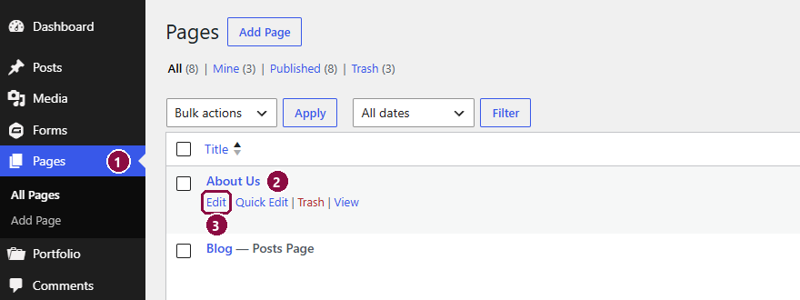
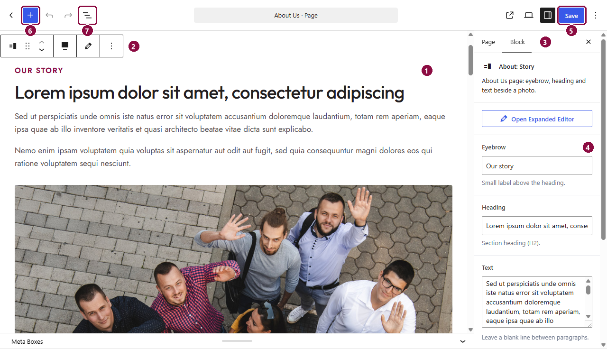
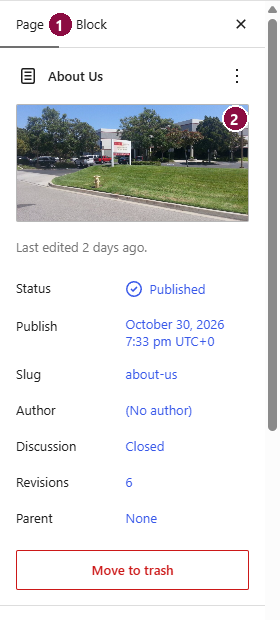
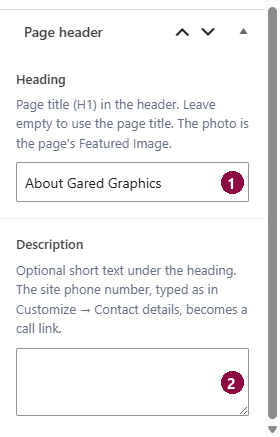
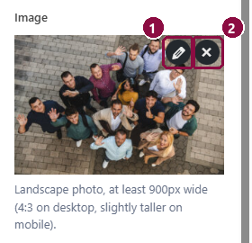
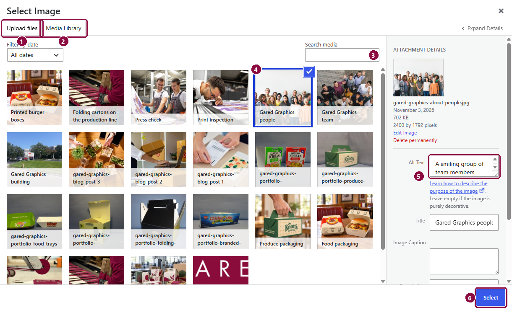
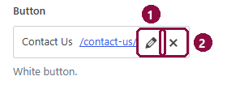
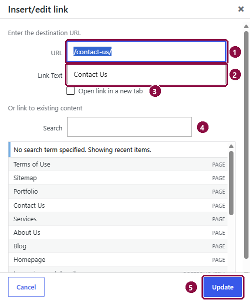
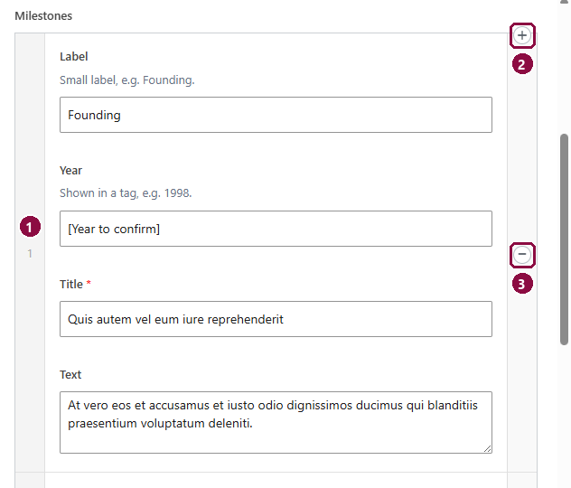
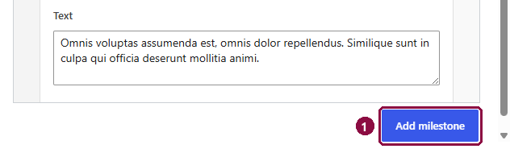

# Editing pages

Every page is made of **sections**, stacked from top to bottom: a photo banner, a block of text beside an image, a row of cards and so on. Each section has its own fields for the text, images and buttons, so you change the words and pictures while the design stays consistent.

## Opening a page

1. Go to **Pages** in the left menu.
2. Find the page, for example *About Us*.
3. Hover over it and click **Edit**.

Or, while viewing the page on your site, click **Edit Page** in the dark bar at the top.

## The editor

1. **The page itself**: a live preview of each section. Click a section to select it.
2. **Section toolbar**: appears above the selected section. Use the arrows to move it up or down, the dotted handle to drag it, and **⋮** for more options such as *Duplicate* or *Delete*.
3. **Block tab**: shows the selected section's fields. (The **Page** tab next to it holds the page's own settings; see below.)
4. **Fields**: change the text, images and buttons here. The preview updates as you type.
5. **Save**: publishes your changes. Nothing changes on the live site until you click it.
6. **Add a section** (+): opens the list of sections. Ours are under **CT Theme**; type a name such as *Text and Image* to find one quickly.
7. **List view**: an outline of every section on the page, handy for jumping to one or dragging sections into a new order.

!!! tip "Bigger editing area"
    Click **Open Expanded Editor** at the top of a section's fields to edit them in a larger window.

## The page header

Most pages start with a header: a wide photo with a dark box holding the page title. Its settings are in the **Page** tab of the right-hand panel.

1. **Page** tab: the page's own settings.
2. **Featured image**: the photo behind the header. Click it to replace it. Without one, the page uses the default photo set in [Site settings](site-settings.md#page-header).

Scroll down the Page tab to the **Page header** fields:

1. **Heading**: the large title in the header. Leave it empty to use the page's name.
2. **Description**: an optional line of text under the title. If you type the site's phone number exactly as it appears in Site settings, it automatically becomes a tap-to-call link.

The home page has no page header; it starts with the large photo banner (the *Hero* section).

## Kinds of fields

Every section uses the same few kinds of fields. Under each field there's a short grey note saying what it's for (for example *Landscape photo, at least 900px wide*).

| Field | How to use it |
|---|---|
| **Text** | A single line, such as a heading or the small label above it (we call that label the *eyebrow*). |
| **Text area** | Paragraphs. Leave a blank line between paragraphs. |
| **Icon** | Pick an icon from the list. Icons come with the theme. |
| **Switch** (*Show phone number*, *Show steps*…) | Turns part of a section on or off. |

Images, buttons and lists of cards work a little differently, so they're shown below.

### Images

1. **Edit** (pencil, appears when you hover over the photo): change the photo's details, such as its alt text.
2. **Remove** (✕): takes the photo out. An **Add Image** button then appears in its place.

Click **Add Image** (or the empty image area) to open the image picker:

1. **Upload files**: drag a photo in from your computer, or click **Select Files**.
2. **Media Library**: every image already on the site.
3. **Search media**: find an image by name.
4. **Click an image** to select it (a blue tick appears).
5. **Alt Text**: a short description of the photo for screen readers and search engines (see [Images](images.md#alt-text)).
6. **Select**: puts the chosen image into the field.

### Buttons and links

1. **Edit** (pencil): change where the button goes or what it says.
2. **Remove** (✕): hides the button. Click **Select Link** to add it back.

1. **URL**: the address the button opens. For a page on your site, use **Search** (4) instead of typing it.
2. **Link Text**: the words on the button.
3. **Open link in a new tab**: only for other websites; leave it unticked for your own pages.
4. **Search**: type part of a page's name and click it in the list; the URL fills in for you.
5. **Update**: saves the link. (**Cancel** leaves it as it was.)

### Lists of cards, steps and points

Cards, steps, milestones, checklist points and similar lists are made of **rows**: one row per card. Lists are easier to edit in the bigger window: click **Open Expanded Editor** at the top of the section's fields.

1. **Row number**: drag it up or down to change the order.
2. **+** (appears when you hover over a row): adds a new row just above this one.
3. **−**: removes this row.

1. **Add** button under the list (named after what it adds, for example *Add milestone*): adds a row at the end.

The design is laid out for a certain number of rows; the grey note under the list says how many fit best (for example *Three cards make one row on desktop*).

## Worked example: change the photo and heading in "Our story"

This walks through a typical edit on the About Us page from start to finish.

1. **Open the page.** Go to **Pages**, hover over **About Us** and click **Edit** (see [Opening a page](#opening-a-page)).
2. **Select the section.** Click anywhere on the *Our story* section in the editor. Its toolbar appears above it, and the **Block** tab on the right shows *About: Story* with its fields (see [The editor](#the-editor)).
3. **Change the heading.** Click in the **Heading** field and type the new heading. The preview updates as you type.
4. **Replace the photo.** Scroll down the fields to **Image**, hover over the photo and click **✕** to remove it, then click **Add Image**. In **Media Library** pick the new photo (or **Upload files** to add one from your computer), check its **Alt Text**, and click **Select** (see [Images](#images)).
5. **Save.** Click **Save** at the top right. A message confirms it's saved.
6. **Check it.** Click the **View page** icon (the square with an arrow, left of the panel buttons) to see the live page.

!!! tip
    Changed your mind before saving? Use **Undo** at the top left, or leave the page without saving. After saving, use **Revisions** (see [Undoing mistakes](#undoing-mistakes)).

## Adding, moving and removing sections

- **Add**: click **+** (6 above), find the section under **CT Theme**, and click it. It's added below the selected section with sample text; replace it with yours.
- **Move**: select the section and use the arrows in its toolbar, or drag it in **List view**.
- **Remove**: select it, click **⋮** in its toolbar, then **Delete**.

Sections are designed for the page they're named after (*About: Story* for About Us, *Services: Process* for Services), but the general ones (*Text and Image*, *Feature Cards*, *Image Cards*, *Contact Band*) can be used on any page.

## Undoing mistakes

- Before you save: use **Undo** (the curved arrow at the top) or leave the page without saving.
- After you save: open the **Page** tab, click **Revisions**, pick an earlier version and click **Restore This Revision**.

## What's on each page

- [Home](pages/home.md)
- [About Us](pages/about.md)
- [Services](pages/services.md)
- [Portfolio](pages/portfolio.md)
- [Contact Us](pages/contact.md)

The **Blog** page lists your posts automatically (see [Blog posts](blog-posts.md)), and the **Sitemap** page lists every page, project and post on its own. **Terms of Use** is plain text you can edit like a document.
