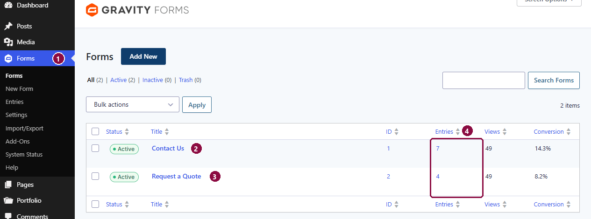

# Forms

The site has two forms, both on the [Contact Us](pages/contact.md) page: **Contact Us** (general messages) and **Request a Quote**. They're run by **Gravity Forms**, under **Forms** in the left menu.

1. **Forms** in the left menu.
2. **Contact Us**: the message form.
3. **Request a Quote**: the quote form.
4. **Entries**: how many messages each form has received. Click the number to read them.

## Reading messages

Every message sent through a form is saved as an **entry**, even if an email goes astray.

1. Go to **Forms → Entries** (or click a form's entry count).
2. Pick the form from the menu at the top if needed.
3. Click an entry to read it. Unread entries are shown in bold; use the star to flag ones to follow up.

To keep a copy outside the website, go to **Forms → Import/Export → Export Entries**, choose the form and the fields, and download a spreadsheet (CSV).

## Who gets the emails

When someone sends a form, two emails go out:

- **To your team**: the full message, with the sender's email set as the reply address, so you can simply click **Reply**.
- **To the visitor**: a confirmation that their message or quote request arrived, with a copy of what they sent.

These are set under **Forms**, then hover over a form and click **Notifications**.

!!! warning "Please ask us before changing notifications"
    Notifications control where messages are delivered. A wrong address means quote requests go missing, so let us know if your team's address changes and we'll update it and send a test.

## The thank-you message

After sending, the visitor sees a short thank-you message in place of the form. To change its wording: **Forms**, hover over the form, **Settings → Confirmations**.

## Spam protection

Both forms are protected against spam robots by an invisible check from Google (reCAPTCHA) and a hidden trap field. Real visitors don't see either. You may notice a small **reCAPTCHA** badge in the bottom-right corner of the Contact page; it needs to stay there.

## Fields and wording

To change a form's questions (labels, the packaging types, quantity ranges), go to **Forms**, hover over the form and click **Edit**. Because the quote buttons on the Services page pre-select a packaging type, please ask us before renaming or removing *Sleeves*, *Boxes* or *Trays*.
