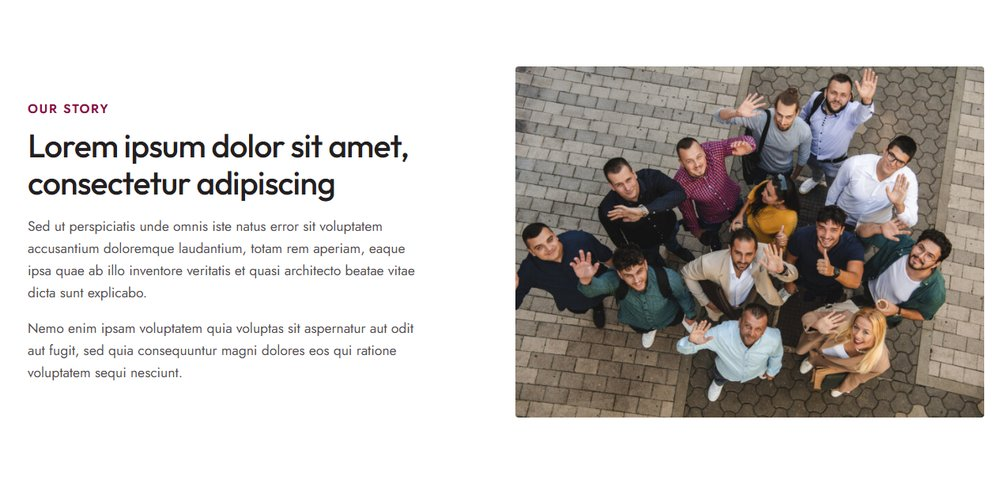
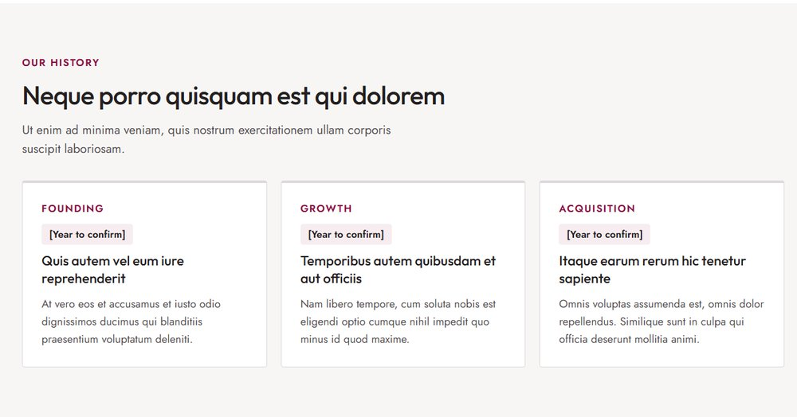
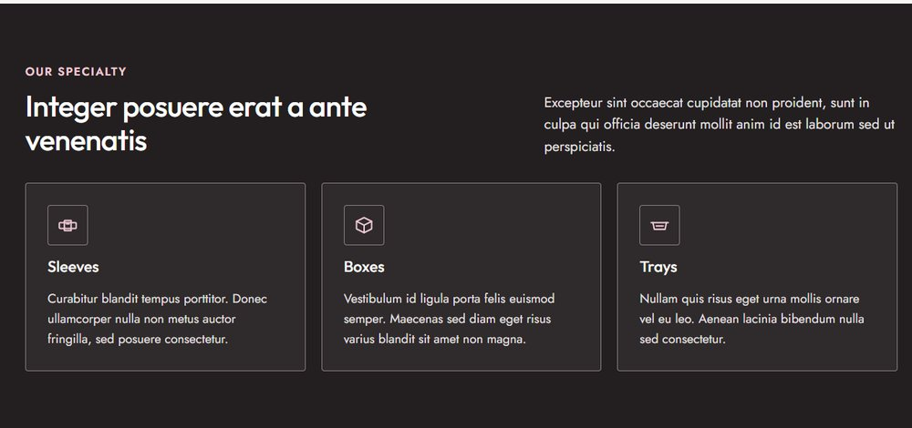
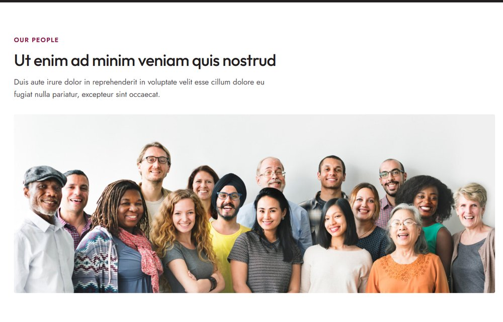
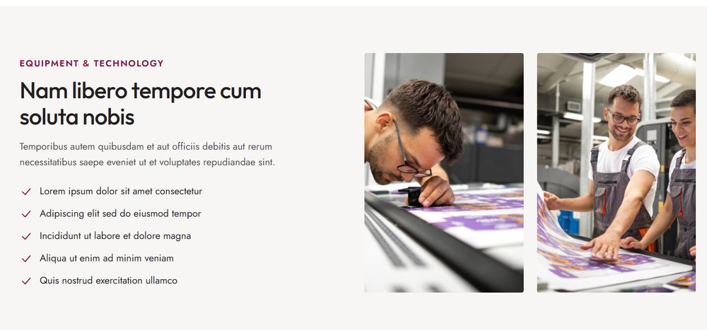

# About Us

Open it from **Pages → About Us → Edit**. The page header (title and photo) is set in the **Page** tab; see [The page header](../editing-pages.md#the-page-header).

!!! tip "How to edit a section"
    Open the page in the editor, click the section you want to change, and its fields appear in the **Block** tab on the right. Change them, then click **Save**. New to the editor? See [Editing pages](../editing-pages.md), including a [worked example](../editing-pages.md#worked-example-change-the-photo-and-heading-in-our-story).

## Our story

Section: **About: Story**. Click it in the editor to see these fields in the **Block** tab.

| Field | What it changes |
|---|---|
| Eyebrow, Heading | The label and heading. |
| Text | The paragraphs. Leave a blank line between paragraphs. |
| Image | The photo on the right. Landscape, at least 900px wide. |

## Our history

Section: **About: History**. Click it in the editor to see these fields in the **Block** tab.

| Field | What it changes |
|---|---|
| Eyebrow, Heading, Text | The label, heading and intro. |
| Milestones | One row per card (three make one row): **Label** (e.g. *Founding*), **Year** (shown in the small tag), **Title**, **Text**. |

## Our specialty

Section: **About: Specialty**. Click it in the editor to see these fields in the **Block** tab.

| Field | What it changes |
|---|---|
| Eyebrow, Heading | The label and heading on the left. |
| Text | The text beside the heading. |
| Cards | One row per card (three make one row): **Icon**, **Title**, **Text**. |

## Our people

Section: **About: People**. Click it in the editor to see these fields in the **Block** tab.

| Field | What it changes |
|---|---|
| Eyebrow, Heading, Text | The label, heading and intro. |
| Image | The wide team photo. At least 1500px wide; it's shown as a wide strip, so keep people away from the top and bottom edges. |

## Equipment and technology

Section: **About: Equipment**. Click it in the editor to see these fields in the **Block** tab.

| Field | What it changes |
|---|---|
| Eyebrow, Heading, Text | The label, heading and intro. |
| Checklist | One row per point; each gets a check mark. |
| Photo 1, Photo 2 | The two photos. Landscape, at least 1200px wide (they're cropped to tall shapes on large screens). |

## Call to action

Section: **About: Call to Action**. Click it in the editor to see these fields in the **Block** tab.

| Field | What it changes |
|---|---|
| Heading, Text | The band's heading and text. |
| Button | The white button. |
