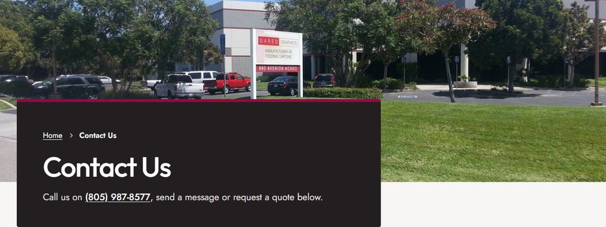
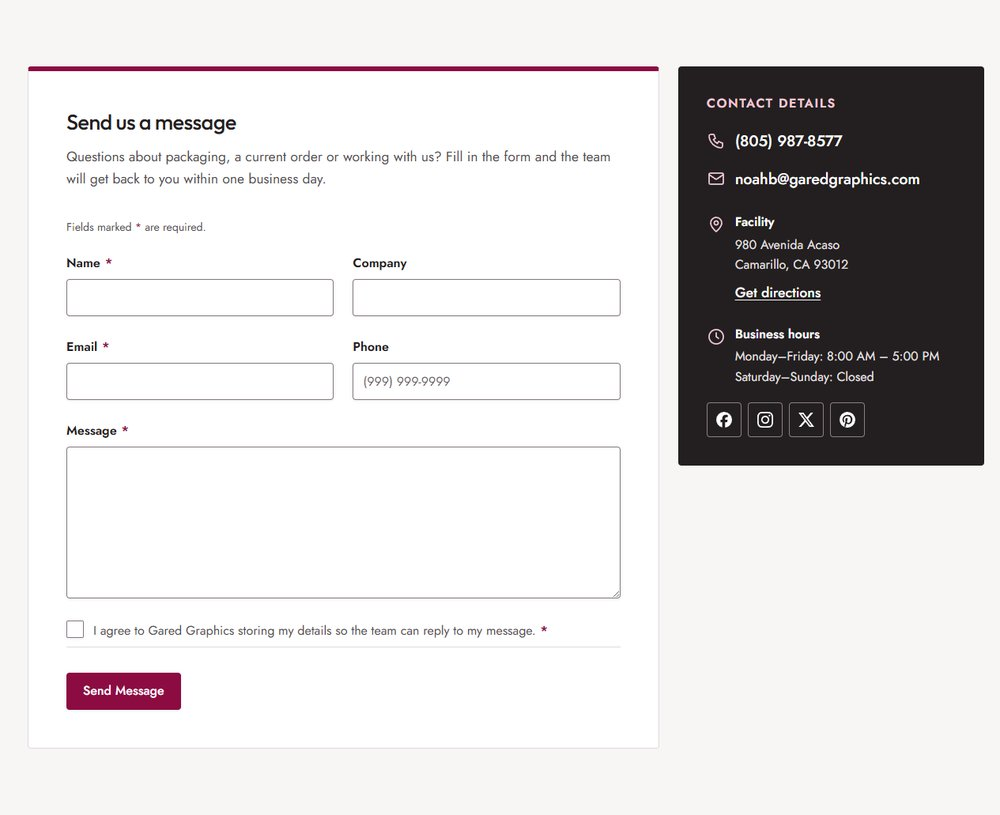
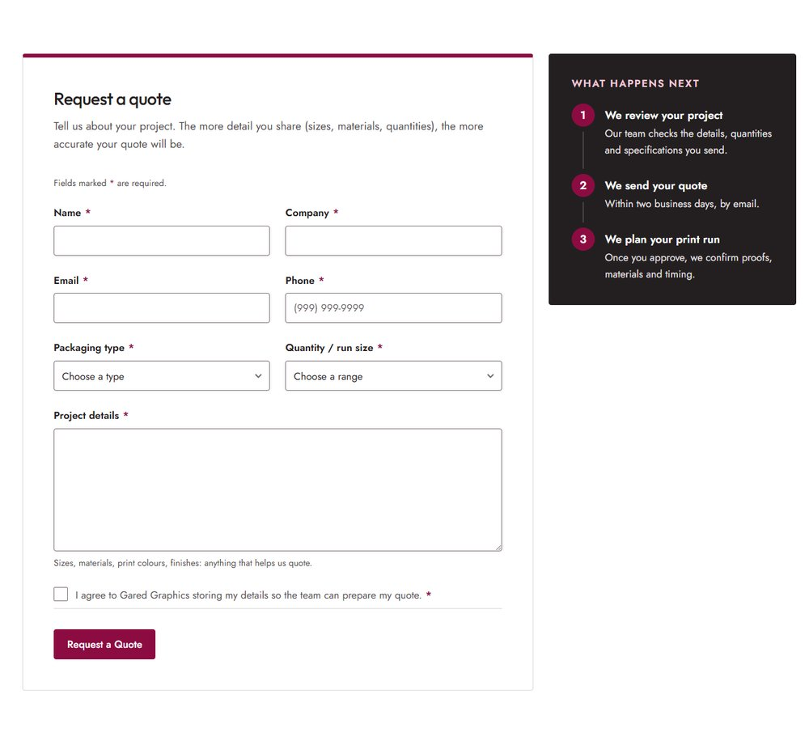
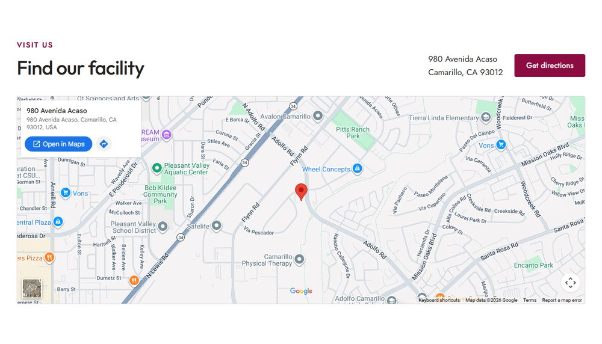

# Contact Us

Open it from **Pages → Contact Us → Edit**. The page header (title, description and photo) is set in the **Page** tab; see [The page header](../editing-pages.md#the-page-header). The phone number in the description becomes a call link automatically.

!!! tip "How to edit a section"
    Open the page in the editor, click the section you want to change, and its fields appear in the **Block** tab on the right. Change them, then click **Save**. New to the editor? See [Editing pages](../editing-pages.md), including a [worked example](../editing-pages.md#worked-example-change-the-photo-and-heading-in-our-story).

The page has two form sections (a message form and a quote form) and a map. The forms' fields and emails are managed under **Forms**; see [Forms](../forms.md).

## Send us a message

Section: **Form Section**. Click it in the editor to see these fields in the **Block** tab.

| Field | What it changes |
|---|---|
| Form | Which form to show (here *Contact Us*). |
| Heading, Intro | The text above the form. |
| Contact heading | The small heading in the dark panel (*Contact details*). |
| Show phone number, Show email | Show or hide them in the panel. |
| Show facility address | Shows the address with a **Get directions** link. |
| Show business hours | Shows the opening hours. |
| Show social links | Shows the social media icons. Only profiles with an address in [Site settings](../site-settings.md#social-links) appear. |
| Show steps | Shows the numbered *What happens next* list instead (used by the quote form). |
| Background | Light grey or white. Use white for a form section right after a grey one, so the two read as separate sections. |

The phone, email, address and hours all come from [Site settings](../site-settings.md#contact-details).

## Request a quote

Section: **Form Section**, with the Request a Quote form and **Show steps** on. Click it in the editor to see these fields in the **Block** tab.

| Field | What it changes |
|---|---|
| Steps heading | The heading above the steps (*What happens next*). |
| Steps | One row per step: **Title** and **Text**, numbered automatically. |

The header's **Request a Quote** button and the Services page buttons link straight to this form.

## Find our facility

Section: **Location Map**. Click it in the editor to see these fields in the **Block** tab.

| Field | What it changes |
|---|---|
| Eyebrow, Heading, Text | The label, heading and optional text. |

The map, the address beside it and the **Get directions** button all use the **Facility address** in [Site settings](../site-settings.md#contact-details). Change the address there and the map moves with it.
