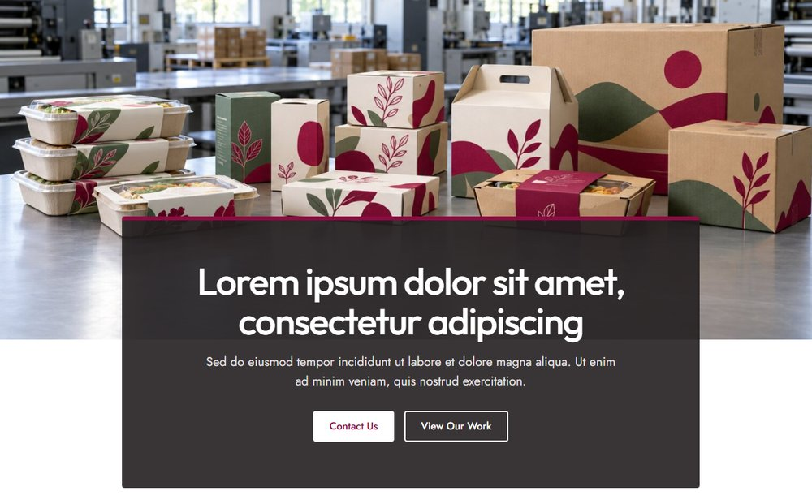
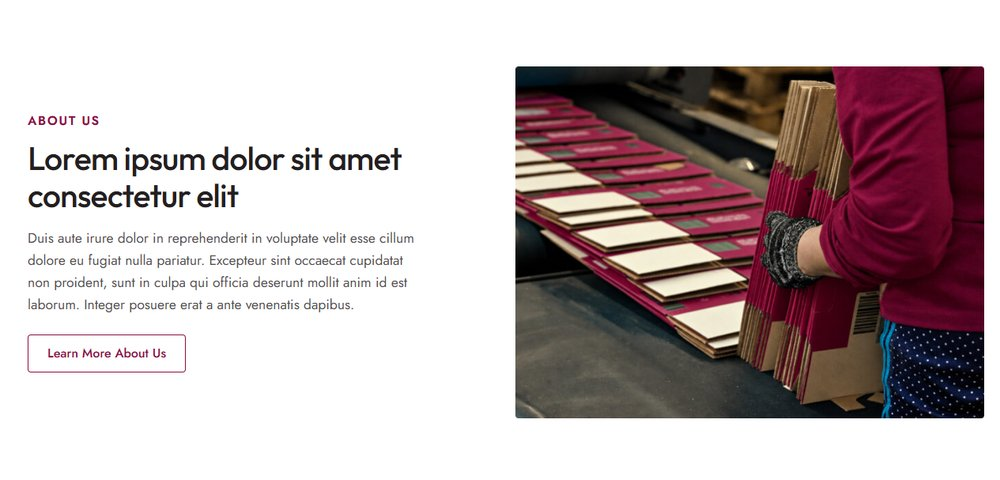
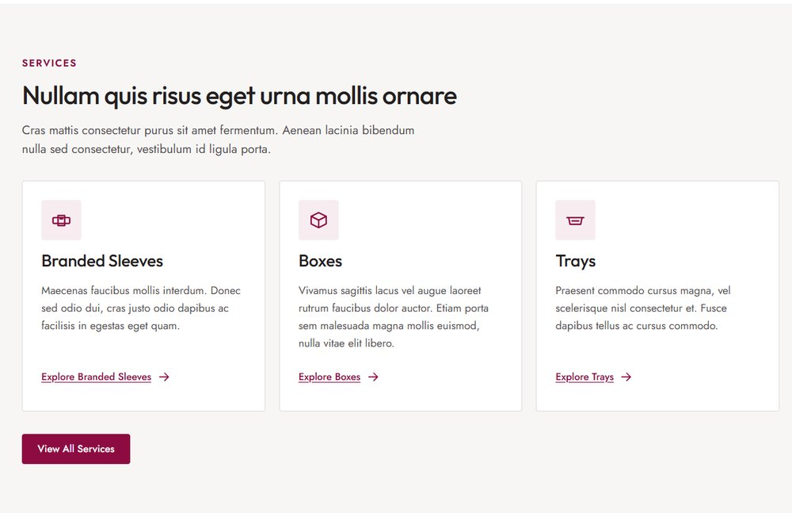
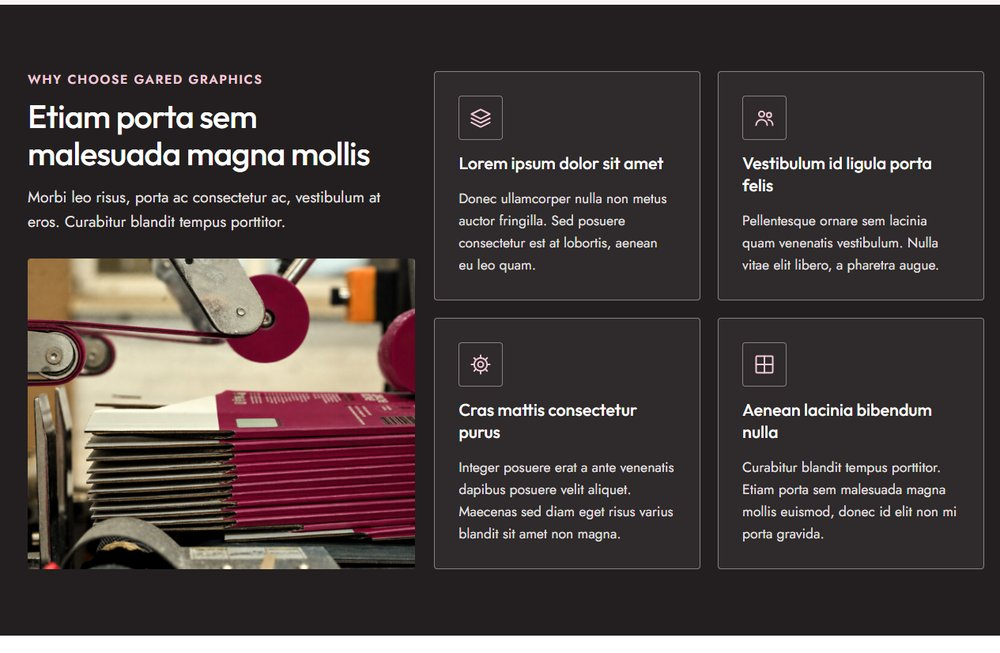
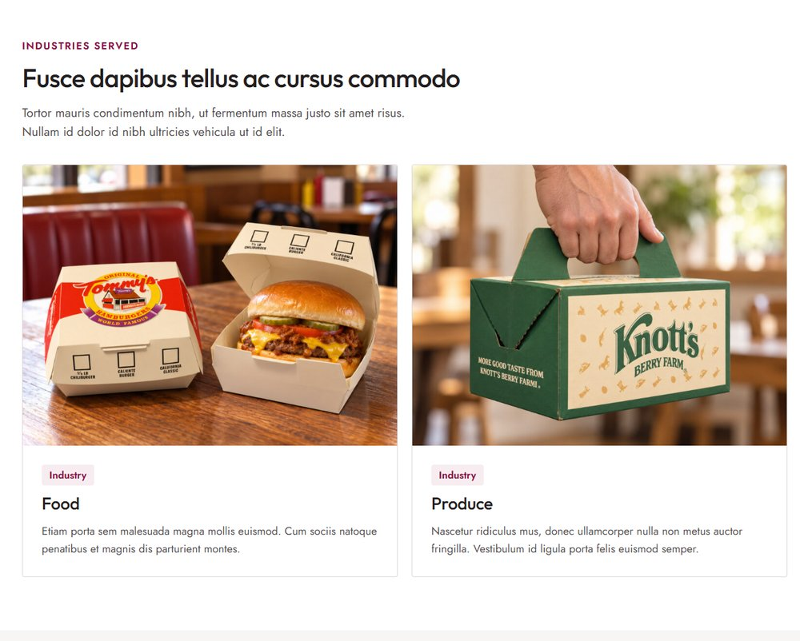
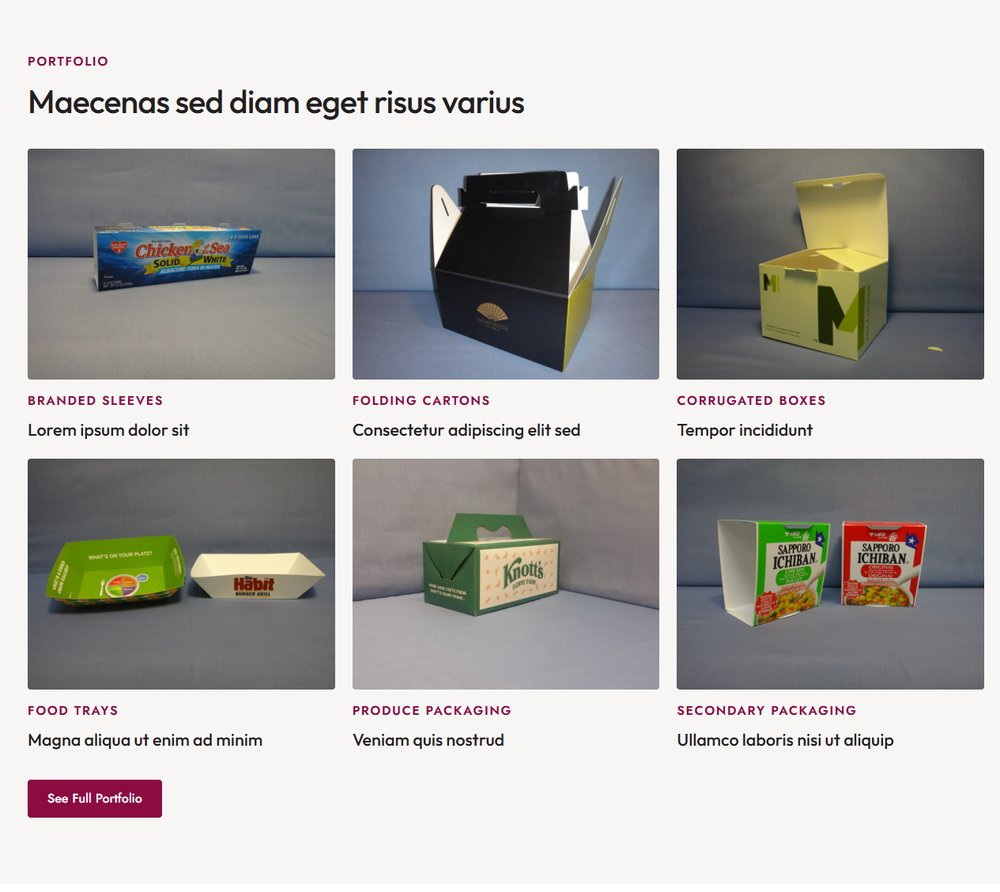
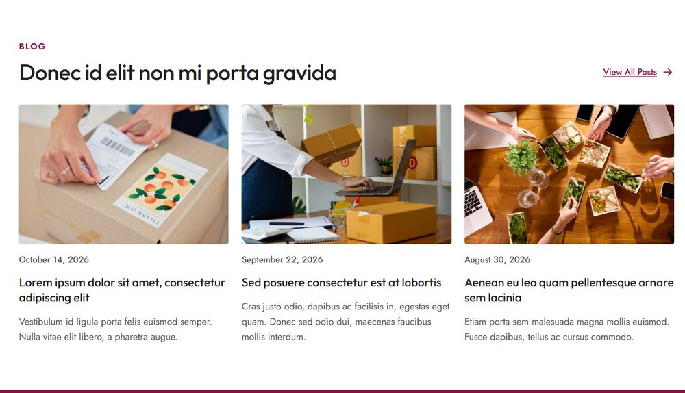

# Home

The home page is made of eight sections. Open it from **Pages → Homepage → Edit**. See [Editing pages](../editing-pages.md) for how the editor works.

!!! tip "How to edit a section"
    Open the page in the editor, click the section you want to change, and its fields appear in the **Block** tab on the right. Change them, then click **Save**. New to the editor? See [Editing pages](../editing-pages.md), including a [worked example](../editing-pages.md#worked-example-change-the-photo-and-heading-in-our-story).

## Hero

Section: **Hero**. Click it in the editor to see these fields in the **Block** tab.

| Field | What it changes |
|---|---|
| Background image | The wide photo. At least 1600px wide; the dark box covers its lower part. |
| Image focus | Which part of the photo stays visible when the screen crops it (Top, Upper middle, Center, Lower middle, Bottom, Left, Right). |
| Heading | The page's main title. |
| Text | The line under the title. |
| Primary button | The white button. |
| Secondary button | The outlined button. |

## About intro

Section: **Text and Image**. Click it in the editor to see these fields in the **Block** tab.

| Field | What it changes |
|---|---|
| Eyebrow | The small burgundy label above the heading. |
| Heading | The section heading. |
| Text | The paragraphs. Leave a blank line between paragraphs. |
| Button | The outlined button under the text. |
| Image | The photo on the right. Landscape, at least 900px wide. |

## Services

Section: **Service Cards**. Click it in the editor to see these fields in the **Block** tab.

| Field | What it changes |
|---|---|
| Eyebrow, Heading, Intro text | The section's label, heading and intro. |
| Cards | One row per card (three fill one row): **Icon**, **Title**, **Text** and an underlined **Link**. |
| Button | The burgundy button under the cards. |

## Why choose Gared Graphics

Section: **Feature Cards**. Click it in the editor to see these fields in the **Block** tab.

| Field | What it changes |
|---|---|
| Eyebrow, Heading, Intro text | The label, heading and text on the left. |
| Image | The photo under the intro. At least 800px wide. |
| Cards | One row per card (four make a 2 × 2 grid): **Icon**, **Title**, **Text**. |

## Industries served

Section: **Image Cards**. Click it in the editor to see these fields in the **Block** tab.

| Field | What it changes |
|---|---|
| Eyebrow, Heading, Intro text | The section's label, heading and intro. |
| Cards | One row per card (two per row): **Image** (at least 800px wide), **Tag** (the small label, e.g. *Industry*), **Title**, **Text**. |

## Portfolio

Section: **Portfolio Grid**. Click it in the editor to see these fields in the **Block** tab.

| Field | What it changes |
|---|---|
| Eyebrow, Heading | The section's label and heading. |
| Number of items | How many projects to show. The latest projects appear automatically; manage them under **Portfolio** (see [Portfolio projects](../portfolio-projects.md)). |
| Button | The burgundy button under the grid. Leave empty to link to the Portfolio page. |

## Blog

Section: **Latest Posts**. Click it in the editor to see these fields in the **Block** tab.

| Field | What it changes |
|---|---|
| Eyebrow, Heading | The section's label and heading. |
| Number of posts | How many posts to show. The latest published posts appear automatically (see [Blog posts](../blog-posts.md)). |
| Link | The arrow link beside the heading. Leave empty to link to the Blog page. |

## Contact band

Section: **Contact Band**. Click it in the editor to see these fields in the **Block** tab.

| Field | What it changes |
|---|---|
| Heading, Text | The band's heading and text. |
| Show phone number, Show email | Show or hide them. The number and address come from [Site settings](../site-settings.md#contact-details). |
| Button | The white button under the contact details. |
