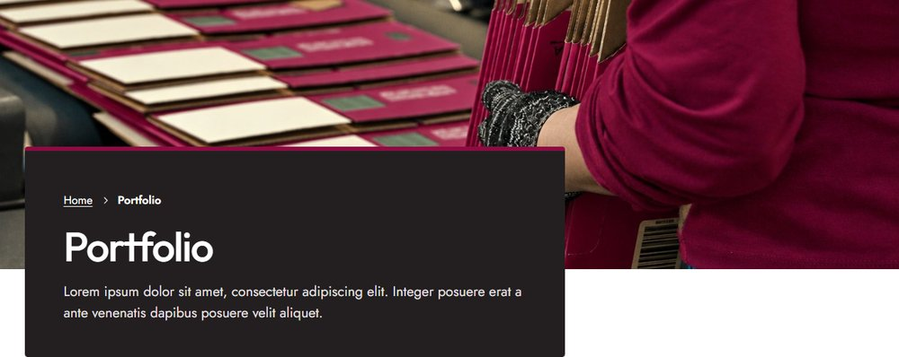
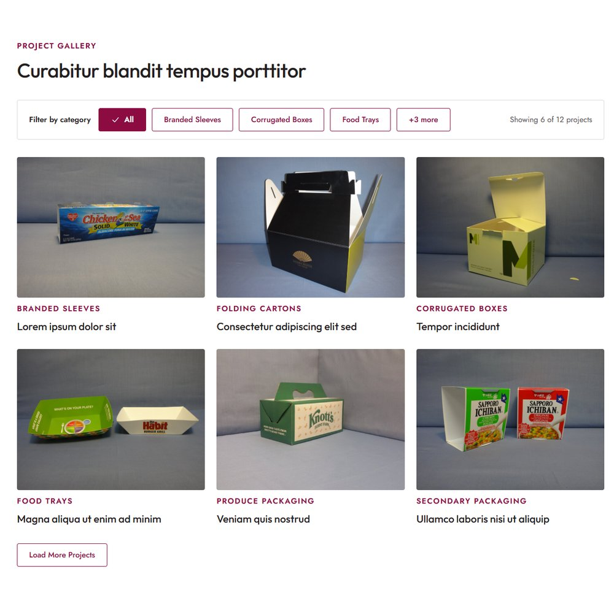
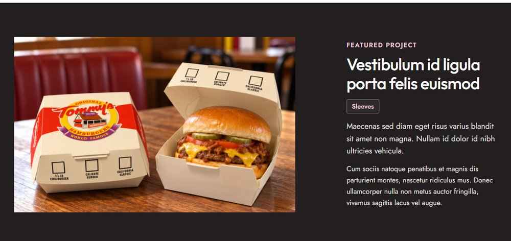
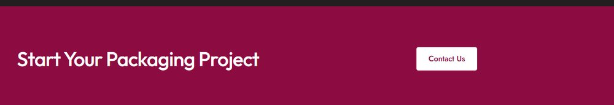

# Portfolio

Open it from **Pages → Portfolio → Edit**. The page header is set in the **Page** tab; see [The page header](../editing-pages.md#the-page-header). The projects themselves are managed separately; see [Portfolio projects](../portfolio-projects.md).

!!! tip "How to edit a section"
    Open the page in the editor, click the section you want to change, and its fields appear in the **Block** tab on the right. Change them, then click **Save**. New to the editor? See [Editing pages](../editing-pages.md), including a [worked example](../editing-pages.md#worked-example-change-the-photo-and-heading-in-our-story).

## Project gallery

Section: **Portfolio: Project Gallery**. Click it in the editor to see these fields in the **Block** tab.

| Field | What it changes |
|---|---|
| Eyebrow, Heading | The label and heading. |
| Main categories | The category buttons shown in the filter bar, in this order. Pick three to match the design; the other categories sit behind the **+ more** button. |
| Projects per load | How many projects show at first, and how many more each **Load More Projects** click adds. |

The projects appear automatically, newest first. Visitors can filter by category, and the page address updates (for example `/portfolio/?category=food-trays`), so a filtered view can be shared as a link.

## Featured project

Section: **Portfolio: Featured Project**. Click it in the editor to see these fields in the **Block** tab.

| Field | What it changes |
|---|---|
| Eyebrow | The small label (*Featured project*). |
| Heading | The project's name. |
| Tag | The short label under the name, e.g. the category. |
| Lead, Text | The first paragraph (slightly larger) and the rest. |
| Image | The project photo. At least 1200px wide. |

This section is written by hand, so it can highlight any project.

## Call to action

Section: **Portfolio: Call to Action**. Click it in the editor to see these fields in the **Block** tab.

| Field | What it changes |
|---|---|
| Heading | The band's heading. |
| Button | The white button. |
