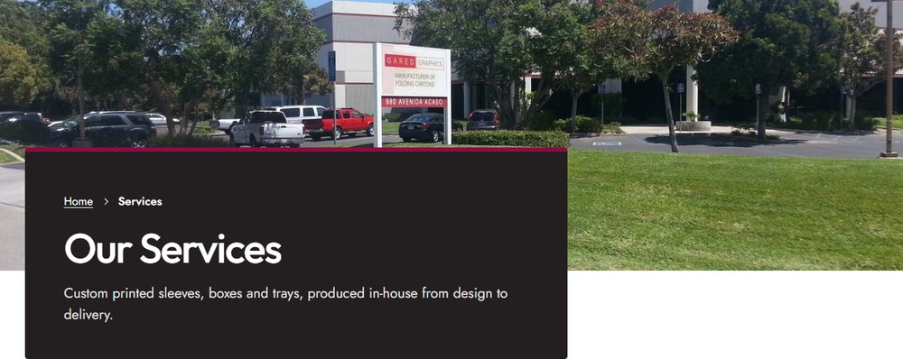
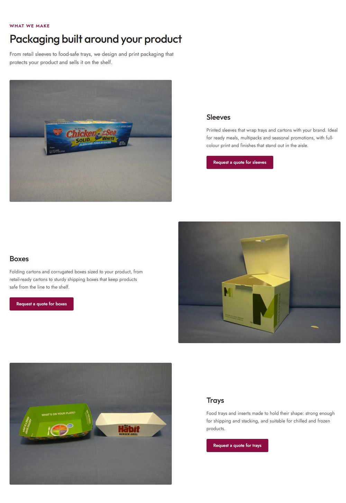
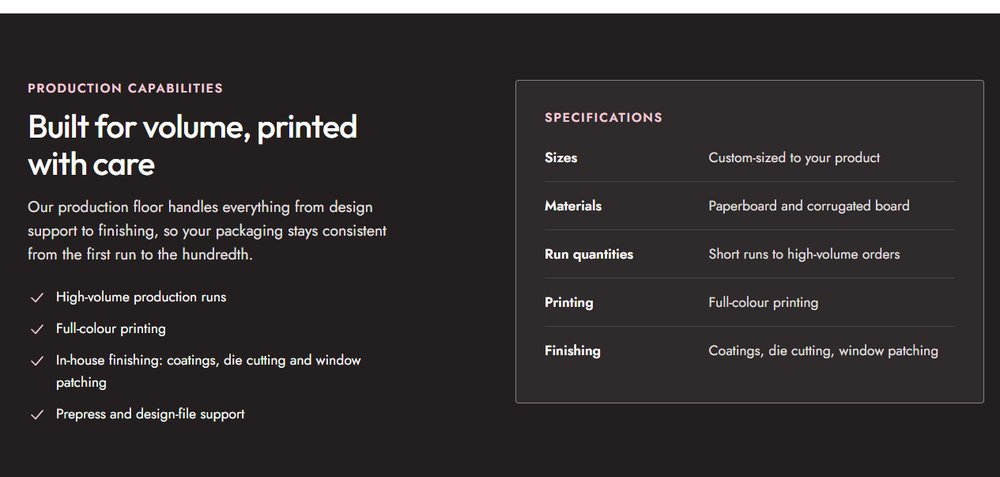
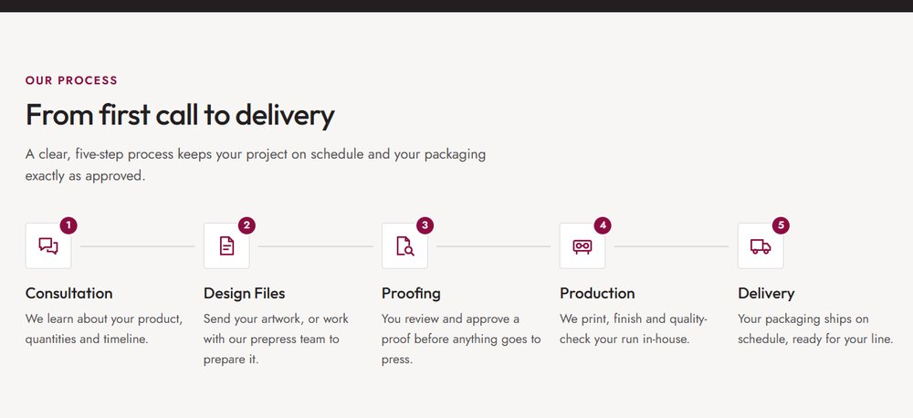
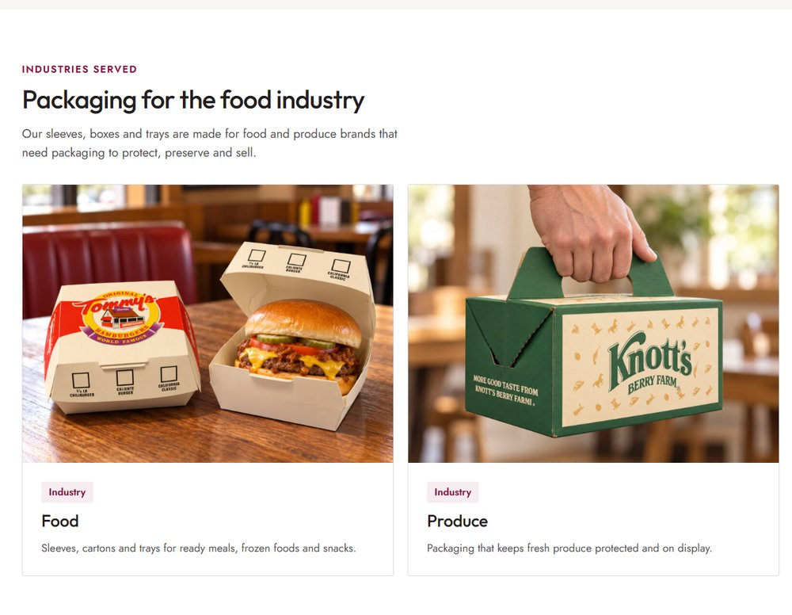

# Services

Open it from **Pages → Services → Edit**. The page header (title, description and photo) is set in the **Page** tab; see [The page header](../editing-pages.md#the-page-header).

!!! tip "How to edit a section"
    Open the page in the editor, click the section you want to change, and its fields appear in the **Block** tab on the right. Change them, then click **Save**. New to the editor? See [Editing pages](../editing-pages.md), including a [worked example](../editing-pages.md#worked-example-change-the-photo-and-heading-in-our-story).

## What we make

Section: **Services: Details**. Click it in the editor to see these fields in the **Block** tab.

| Field | What it changes |
|---|---|
| Eyebrow, Heading, Intro | The label, heading and intro. |
| Services | One row per service; the photo alternates sides. Each has a **Photo** (landscape), **Heading**, **Description**, **Packaging type for the quote form** and **Button label**. |

The button opens the quote form on the Contact page with the chosen **packaging type** (Sleeves, Boxes or Trays) already selected. Leave **Button label** empty for *Request a quote for* followed by the heading.

## Production capabilities

Section: **Services: Capabilities**. Click it in the editor to see these fields in the **Block** tab.

| Field | What it changes |
|---|---|
| Eyebrow, Heading, Intro | The label, heading and intro on the left. |
| Capabilities | One row per point; each gets a check mark. |
| Table heading | The small heading above the table (*Specifications*). |
| Specifications | One row per line of the table: **Label** (e.g. *Materials*) and **Details**. |

## Our process

Section: **Services: Process**. Click it in the editor to see these fields in the **Block** tab.

| Field | What it changes |
|---|---|
| Eyebrow, Heading, Intro | The label, heading and intro. |
| Steps | One row per step, numbered automatically (five fit one row): **Icon**, **Title**, **Short description**. |

## Industries served

Section: **Services: Industries**. Click it in the editor to see these fields in the **Block** tab.

| Field | What it changes |
|---|---|
| Eyebrow, Heading, Supporting copy | The label, heading and text. |
| Industries | One tile per industry (two per row): **Photo**, **Tag**, **Title**, **Text**. |

## Call to action

Section: **Services: Call to Action**. Click it in the editor to see these fields in the **Block** tab.

| Field | What it changes |
|---|---|
| Headline, Supporting copy | The band's heading and text. |
| Button | The white button. Leave empty for *Request a Quote*, which opens the quote form on the Contact page. |
