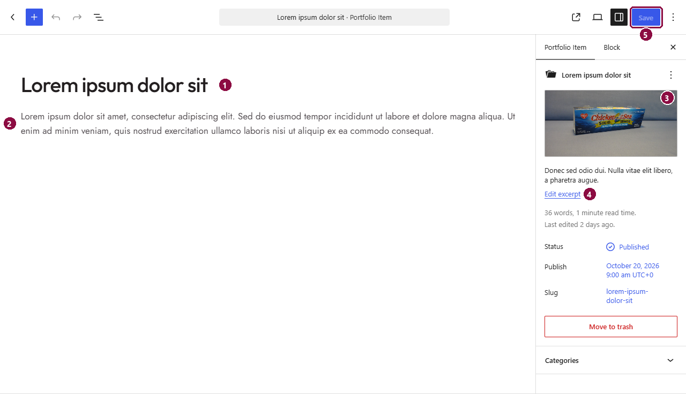
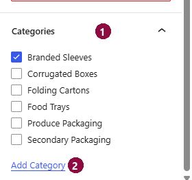

# Portfolio projects

Each project you've produced is a **Portfolio item**. Projects appear automatically in the gallery on the Portfolio page, in the *Portfolio* section of the home page (newest first), and in the sitemap. Each one also gets its own page.

## Adding or editing a project

Go to **Portfolio → Add New** (or **Portfolio**, then click a project's name to edit it).

1. **Title**: the project's name, shown on its card and as the heading of its page.
2. **Description**: the text on the project's page. Type straight into the page; press Enter for a new paragraph.
3. **Featured image**: the photo on the project's card and at the top of its page. Click it to set or replace it. Use a landscape photo at least 1200px wide; cards show it at 4:3.
4. **Excerpt**: a one-line summary used where a short description is needed, for example in search results.
5. **Save** (or **Publish** for a new project): makes your changes live.

## Categories

Scroll down the right-hand panel to **Categories**.

1. **Categories**: tick the category the project belongs to. The first one ticked is shown on the project's card, and it decides which filter button finds the project in the gallery. One category per project works best.
2. **Add Category**: creates a new category. Manage all of them under **Portfolio → Categories** (rename, or change the web address part called the *slug*).

!!! note
    New categories appear in the gallery's filter automatically, behind the **+ more** button. To make one of the three main buttons, change **Main categories** in the gallery section on the Portfolio page (see [Portfolio](pages/portfolio.md#project-gallery)).

## Removing a project

In **Portfolio**, hover over the project and click **Trash**. It disappears from the site straight away and stays in **Trash** for 30 days, where you can restore it.
